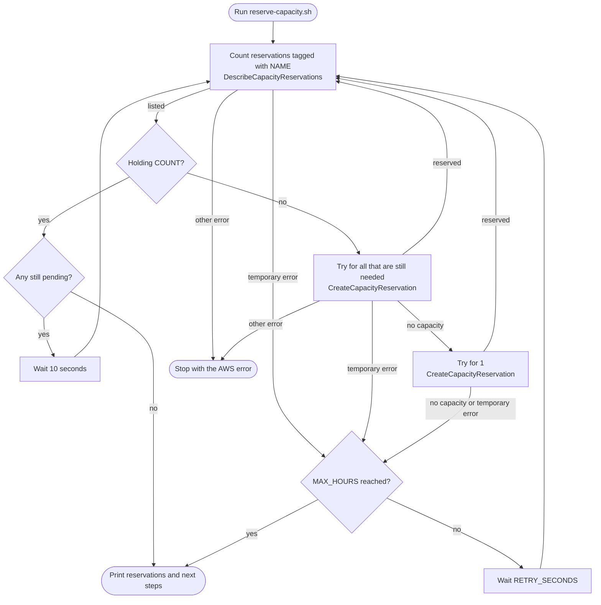

# Reserve scarce GPU capacity with On-Demand Capacity Reservations

When an instance type such as a large GPU instance has no capacity, a request
that fails now can still succeed a few minutes or hours later. This Bash script
keeps trying to create
[On-Demand Capacity Reservations](https://docs.aws.amazon.com/AWSEC2/latest/UserGuide/ec2-capacity-reservations.html)
(ODCRs) until it holds the number of instances you asked for, and it keeps
whatever it gets along the way.

> This is sample code for demonstration and learning. It is **not
> production-ready** and must be reviewed, tested, and hardened for your own
> security and compliance requirements before any production use.

> **Billing:** each reservation is charged at the On-Demand rate from the moment
> the script creates it, even if no instance uses it, until you cancel it. See
> [Cost](#cost) and [Clean up](#clean-up).

## How it works

A Capacity Reservation holds capacity for your account for one instance type in
one Availability Zone. The script creates **open** reservations, which AWS
applies automatically to any instance you start with the same instance type,
platform (Linux/UNIX), tenancy (default) and Availability Zone. You do not need
to add a reservation ID when you start the instance, but an instance that
starts in a different zone does not use the reservation.

By default every 2 minutes, the script counts what it already holds and tries
to reserve the rest. If AWS cannot supply all of the rest in one request, it
tries for a single instance instead:



If AWS cannot list the reservations because of a temporary error, such as
throttling or a lost connection, the script does not guess. It waits and counts
again, so that a failed call cannot make it book the request a second time. If
the listing fails for any other reason, such as expired credentials or a
permissions error, it stops with the AWS error. What the request holds stays
reserved, and you can run the script again with the same `NAME`.

After a temporary error on create, the next round first repeats that call, with
the same count and client token. If the first call did succeed, AWS returns
that reservation instead of creating a new one.

## Partial results and running it again

Each run belongs to a request that you name with `NAME`, for example
`team-a-training`. The script tags every reservation it creates with
`reserve-capacity-request=<NAME>`, and it uses that tag, not a local file, to
work out how many instances the request already holds. This means you can stop
the script, close your laptop, and run it again the next day without booking
too many. AWS can take a few seconds to list a reservation it has just
created, so the script also counts its own new reservations until AWS lists
them, and it waits for new reservations to leave the `pending` state before it
reports that it is done. If a new reservation fails, it stops counting it and
tries again.

Here is an example with `NAME=team-a-training` and `COUNT=3`:

| Time | Request holds | What happens |
|---|---|---|
| First 20 minutes | 0 | No capacity, so the script keeps trying |
| After 22 minutes | 1 | One instance becomes free and the script reserves it. Billing starts for that one |
| Next 8 hours | 1 | No capacity for the other 2. When `MAX_HOURS` passes, the script stops and the 1 stays reserved |
| The next day, you run it again with the same `NAME` | 1, then 3 | The script finds the 1 it already holds, asks for 2, and reserves them |

The rules behind this:

- **Same `NAME`:** the script continues the request and only asks for what is
  missing. If you raise `COUNT`, it reserves the extra instances. If you lower
  `COUNT`, it does not cancel anything.
- **New `NAME`:** the script starts a separate request, and reservations from
  other requests do not count toward it.
- **Same `NAME` with a different `ZONE` or `INSTANCE_TYPE`:** the script stops
  and lists what the request already holds, so that a typo does not quietly
  reserve a second set somewhere else.
- **`--cancel`:** cancels only the reservations of that `NAME`. Reservations
  from other requests, or ones you created in the console, are not touched.

**Run only one copy of the script per `NAME` at a time.** Two copies running
together can both decide that 2 more instances are needed and reserve more
than `COUNT`.

## Prerequisites

- Bash 3.2 or later (the version macOS ships works) and AWS CLI v2, with
  credentials for the account you want to reserve in.
- An IAM identity with the permissions in [IAM permissions](#iam-permissions).
- A Region and Availability Zone where the instance type is offered. The
  script checks this before it creates anything.
- Enough On-Demand vCPU quota for the instance family, because
  [reservations count against the same quota as running instances](https://docs.aws.amazon.com/AWSEC2/latest/UserGuide/ec2-capacity-reservations.html#capacity-reservations-limits).
  For example, 3 x g7e.48xlarge (192 vCPUs each) needs 576 vCPUs of the
  "Running On-Demand G and VT instances" quota (`L-DB2E81BA`), on top of any G
  and VT instances that are already running. If the quota is too low, AWS
  rejects the request and the script stops with the AWS error instead of
  retrying.

## How to run

1. Set the values at the top of `reserve-capacity.sh`, or pass them as
   environment variables:

   | Setting | Required | Default | Meaning |
   |---|---|---|---|
   | `ACCOUNT_ID` | Yes | | Account to reserve in. The script stops if your credentials are for a different account |
   | `NAME` | Yes | | Name of the request, for example `team-a-training` |
   | `ZONE` | Yes | | Zone name such as `us-east-1b`, or zone ID such as `use1-az2`. See [Zone names and zone IDs](#zone-names-and-zone-ids) |
   | `INSTANCE_TYPE` | Yes | | Instance type to reserve, for example `g7e.48xlarge` |
   | `COUNT` | Yes | | Total number of instances the request should hold, for example `3` |
   | `AWS_REGION` | No | Your AWS CLI region | Region of `ZONE`. The script stops if this is not set anywhere |
   | `RETRY_SECONDS` | No | `120` | Wait between rounds. AWS keeps every request that fails for lack of capacity as a reservation in the `failed` state, so a shorter wait leaves more of these records |
   | `MAX_HOURS` | No | `8` | How long to keep trying, so that a forgotten run does not retry forever. Raise it for a long search, for example `72` |

2. Run the script:

   ```bash
   chmod +x reserve-capacity.sh
   ACCOUNT_ID=111122223333 NAME=team-a-training ZONE=us-east-1b INSTANCE_TYPE=g7e.48xlarge COUNT=3 ./reserve-capacity.sh
   ```

   While it waits, the output looks like this:

   ```text
   Request 'team-a-training': 3 x g7e.48xlarge in us-east-1b (use1-az2) (account 111122223333). Already holding 0.
   Holding 0 of 3
   18:04:25 no capacity for 3
   18:04:28 no capacity for 1
   ```

3. For a long run, keep the terminal open. On a Mac, put `caffeinate -i` in
   front of the command so the laptop does not sleep. On a small EC2 instance
   with an instance role that has the [IAM permissions](#iam-permissions), set
   the values in the script and start it with
   `nohup ./reserve-capacity.sh > reserve.log 2>&1 &`, so that it keeps running
   after you log out.

To see every AWS CLI command the script runs, put `DEBUG=1` in front of the
command.

## Check the result

When the script finishes, it prints the reservation IDs of the request. You
can also list them at any time:

```bash
aws ec2 describe-capacity-reservations --region us-east-1 \
  --filters Name=tag:reserve-capacity-request,Values=team-a-training Name=state,Values=active \
  --query 'CapacityReservations[].[CapacityReservationId,AvailabilityZone,InstanceType,TotalInstanceCount,AvailableInstanceCount]' \
  --output table
```

`AvailableInstanceCount` is the number of reserved slots that no instance is
using yet. After you start an instance, you can open it in the EC2 console to
check that it is using a reservation: the Capacity Reservation field shows an
ID that starts with `cr-`.

## Zone names and zone IDs

AWS assigns zone names to physical zones randomly for each account, so
`us-east-1b` in your account might not be the same physical zone as
`us-east-1b` in another account. Zone IDs such as `use1-az2` point to the same
physical zone in every account
([Availability Zone IDs](https://docs.aws.amazon.com/ram/latest/userguide/working-with-az-ids.html)).
If the zone you want comes from outside your account, for example from another
team, use the zone ID.

`ZONE` accepts either form. The script looks up the other form for your account
and prints both, for example `us-east-1b (use1-az2)`. To see the mapping for
your account, run:

```bash
aws ec2 describe-availability-zones --region us-east-1 \
  --query 'AvailabilityZones[].[ZoneName,ZoneId]' --output text
```

## IAM permissions

The script calls only the actions below. Cancelling is limited to reservations
that carry the script's `reserve-capacity-request` tag. Replace `<REGION>` and
`<ACCOUNT_ID>` with your values. The `ReadOnly` statement uses `"Resource": "*"`
because these actions do not support resource-level permissions
([Actions, resources, and condition keys for Amazon EC2](https://docs.aws.amazon.com/service-authorization/latest/reference/list_amazonec2.html)).

```json
{
  "Version": "2012-10-17",
  "Statement": [
    {
      "Sid": "ReadOnly",
      "Effect": "Allow",
      "Action": [
        "sts:GetCallerIdentity",
        "ec2:DescribeCapacityReservations",
        "ec2:DescribeAvailabilityZones",
        "ec2:DescribeInstanceTypeOfferings"
      ],
      "Resource": "*"
    },
    {
      "Sid": "CreateTaggedReservations",
      "Effect": "Allow",
      "Action": "ec2:CreateCapacityReservation",
      "Resource": "arn:aws:ec2:<REGION>:<ACCOUNT_ID>:capacity-reservation/*"
    },
    {
      "Sid": "TagOnCreateOnly",
      "Effect": "Allow",
      "Action": "ec2:CreateTags",
      "Resource": "arn:aws:ec2:<REGION>:<ACCOUNT_ID>:capacity-reservation/*",
      "Condition": {
        "StringEquals": { "ec2:CreateAction": "CreateCapacityReservation" }
      }
    },
    {
      "Sid": "CancelOnlyScriptReservations",
      "Effect": "Allow",
      "Action": "ec2:CancelCapacityReservation",
      "Resource": "arn:aws:ec2:<REGION>:<ACCOUNT_ID>:capacity-reservation/*",
      "Condition": {
        "Null": { "aws:ResourceTag/reserve-capacity-request": "false" }
      }
    }
  ]
}
```

## Security

- The script stores no credentials. It uses the AWS CLI credentials that you
  already have configured.
- Before it creates anything, it checks that the credentials belong to
  `ACCOUNT_ID`, so that it cannot reserve capacity in the wrong account.
- It stops on an AWS error that retrying will not fix, such as expired
  credentials, a quota error or a permissions error. It retries "no capacity",
  throttling, AWS internal errors and lost connections.

## Cost

You are responsible for the cost of the AWS services used while running this
sample. There is no additional cost for the sample itself.

A Capacity Reservation is charged at the On-Demand rate for its instance type
from the moment it is created until you cancel it, whether or not an instance
uses it. While a matching instance runs in the reservation, you pay for the
instance and nothing for the reservation, so you are not charged twice. See
[Capacity Reservation pricing and billing](https://docs.aws.amazon.com/AWSEC2/latest/UserGuide/capacity-reservations-pricing-billing.html).

For example, at the time of writing, one g7e.48xlarge in us-east-1 costs
$33.14 per hour On-Demand for Linux. Three reservations held for 24 hours
therefore cost about $2,386, even if no instance runs in them. Prices change,
so check [Amazon EC2 On-Demand Pricing](https://aws.amazon.com/ec2/pricing/on-demand/)
for your instance type and Region.

## Clean up

To cancel every reservation of a request, run:

```bash
ACCOUNT_ID=111122223333 AWS_REGION=us-east-1 NAME=team-a-training ./reserve-capacity.sh --cancel
```

`--cancel` looks only in `AWS_REGION`, so use the Region you reserved in. If a
reservation cannot be cancelled, the script says so and exits with an error;
run `--cancel` again.

Instances that keep running after you cancel are billed at the normal
On-Demand rate.

## Limitations

- The script creates only open, immediate reservations for Linux/UNIX with
  default tenancy and no end date. For Windows, dedicated tenancy, targeted
  reservations, or an automatic end date, change the `create-capacity-reservation`
  call in the script.
- Each request covers one instance type in one Availability Zone. For several
  zones, run one request per zone, each with its own `NAME`.
- Only one copy should run per `NAME` at a time. See
  [Partial results and running it again](#partial-results-and-running-it-again).
- The protection against booking twice holds within one run. If you stop the
  script while it is creating a reservation, wait a minute before you run it
  again, so that AWS lists any reservation that the stopped call created.
- The script stops when its terminal closes or the computer sleeps. For a long
  search, run it on a small EC2 instance as described in [How to run](#how-to-run).

## What was tested

These cases were run against a real account with g4dn.xlarge and t3.micro,
because no g7e.48xlarge capacity was available during testing:

| Case | Result |
|---|---|
| Reserve 1, then run again with the same `NAME` | The second run found the 1 and booked nothing more |
| A second `NAME` in the same zone and instance type | It ignored the first request and reserved its own |
| The same `NAME` with a different zone or instance type | It stopped and listed what the request already held |
| Raise `COUNT` from 1 to 2, then lower it back to 1 | It reserved 1 more, then cancelled nothing and said so |
| `--cancel` with two requests in the same zone | It cancelled only that `NAME`'s reservations |
| No g7e.48xlarge capacity | It tried for 3, then for 1, and kept retrying |
| Wrong account, invalid settings, zone typo, or an instance type not offered in the zone | It stopped with a clear error before creating anything |
| `ZONE` given as a zone ID | It found the zone name for the account and reserved there |
| Bash 3.2, the version macOS ships, with a stand-in AWS CLI | Settings checks, the retry loop, the zone check and `--cancel` behaved the same as on Bash 5 |
| Stand-in AWS CLI that hides new reservations from `DescribeCapacityReservations` for a few seconds | Asking for 3 at once made exactly 1 request; asking 1 at a time made exactly 3; a new reservation that failed was replaced, and the request ended with 3 |
| Real run with `t3.micro` in `use1-az2` after adding the client token | Reserved 2 in one request; running again booked nothing; `--cancel` removed them |
| Stand-in AWS CLI where one `DescribeCapacityReservations` call fails after the request holds 2 of 3 | It waited and counted again, and the request ended with exactly 3 |
| Stand-in AWS CLI where `CreateCapacityReservation` loses the connection after AWS created the reservation | It tried again with the same client token, got the same reservation back, and the request ended with 2 of 2 |
| Stand-in AWS CLI where the "try for 1" call loses the connection after AWS created the reservation, and AWS lists it late | It repeated the call for 1 with the same token, then reserved the other 2, and the request ended with exactly 3 |
| Stand-in AWS CLI where credentials expire between rounds | It stopped at the next listing with the `ExpiredToken` error and exit code 1. A permissions error on listing stopped it the same way |
| Stand-in AWS CLI where one of two cancels fails | It cancelled the other, said which one failed, and exited with an error |
| Stand-in AWS CLI that prints a warning on stderr when a create succeeds | It recorded the reservation and continued. It reads the ID from stdout only |
| An unknown argument, such as `--cancle` | It stopped before calling AWS |
| Real run with `t3.micro` in `usw2-az1`, zone given as a zone ID | Reserved 2; running again booked nothing; raising `COUNT` to 3 booked 1 more; the same `NAME` with `t3.small` stopped; an instance type not offered and a wrong `ACCOUNT_ID` stopped with exit code 1; `--cancel` removed all 3, and a second `--cancel` found nothing |
| IAM policy above, with a real Region and account filled in | The IAM policy simulator allowed every action the script calls in that Region, denied them in another Region, and denied tagging after creation and cancelling untagged reservations |

Not tested: a successful g7e.48xlarge reservation, a live run under the IAM
policy as its own role, and two copies running at the same time.

## License

Apache-2.0. See the repository root [LICENSE](../../LICENSE).
