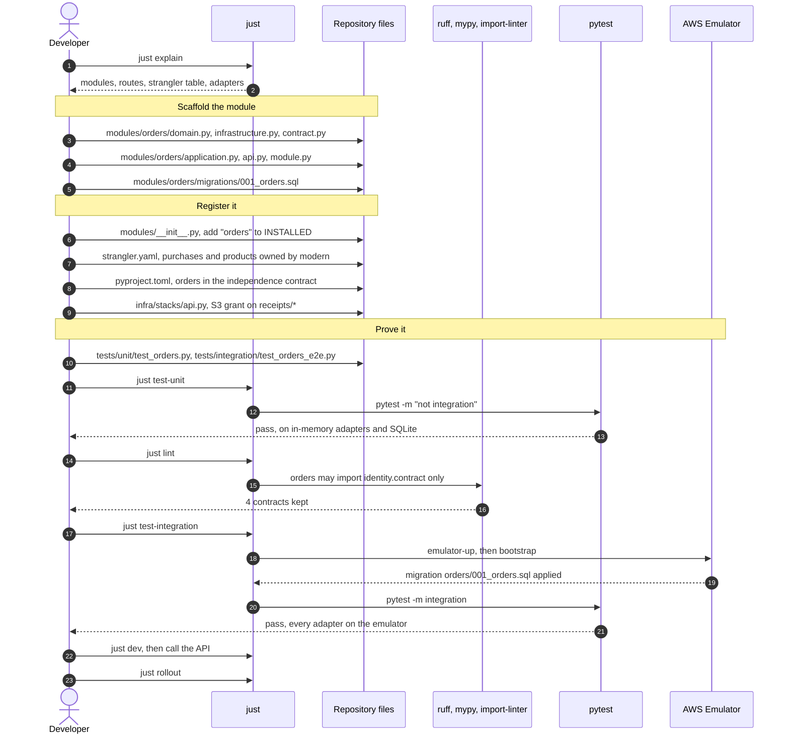
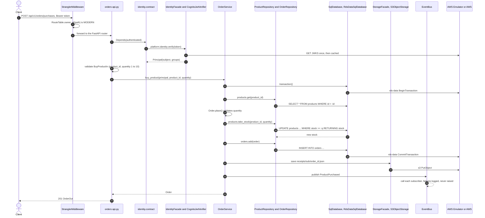
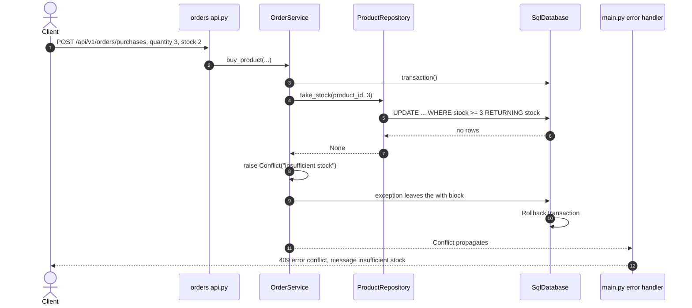
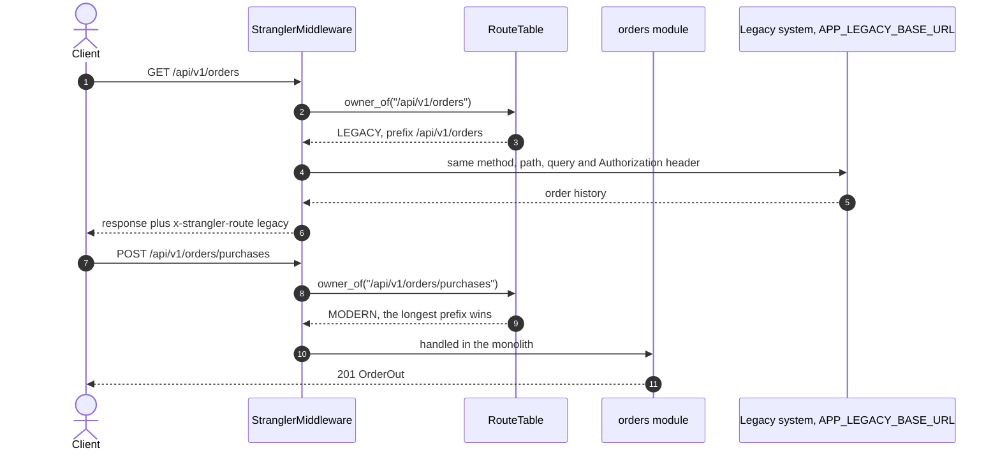
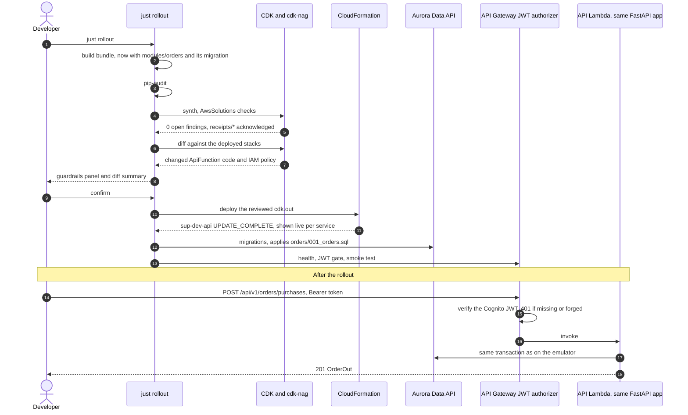

# Building a feature: buy_product

This guide adds a `buy_product` feature end to end, following the boilerplate structure: a new `orders` module, its SQL tables, a strangler route that takes purchases away from the legacy system, tests on in-memory adapters and on the AWS Emulator, and the CDK change it needs before `just rollout`.

The finished code ships as [buy-product.patch](buy-product.patch). Apply it from this folder with `patch -p1 < docs/guides/buy-product.patch`. The snippets below are abridged from it; with the patch applied, the project passes `just lint`, 68 unit tests, 8 integration tests on the emulator, and `cdk synth` with 0 open cdk-nag findings. The patched version has not been deployed to AWS; section 7 shows what `just rollout` does with it.

What the feature does:

- `GET /api/v1/orders/products`: catalog with stock.
- `POST /api/v1/orders/purchases`: buy `quantity` of `product_id` as the logged-in user. Stock is decremented atomically; a purchase that would oversell gets 409 and changes nothing.
- `GET /api/v1/orders/purchases`: the caller's orders.
- `GET /api/v1/orders/purchases/{order_id}/receipt`: presigned URL for the JSON receipt stored in S3.
- Publishes a `ProductPurchased` event other modules can subscribe to.

## Files you touch

| File | Why |
|---|---|
| `src/app/modules/orders/domain.py` | `Product`, `Order`, `Order.place()` validates quantity |
| `src/app/modules/orders/migrations/001_orders.sql` | `products` and `orders` tables, `CHECK (stock >= 0)`, seed catalog |
| `src/app/modules/orders/infrastructure.py` | `ProductRepository` (with the atomic `take_stock`), `OrderRepository` |
| `src/app/modules/orders/contract.py` | `ProductPurchased` event, the only file other modules may import |
| `src/app/modules/orders/application.py` | `OrderService.buy_product()`: transaction, receipt, event |
| `src/app/modules/orders/api.py` | FastAPI routes and DTOs, `CurrentPrincipal` from `identity.contract` |
| `src/app/modules/orders/module.py` | `MODULE = ModuleSpec(...)` wires the service to the platform facades |
| `src/app/modules/__init__.py` | `"orders"` in `INSTALLED` |
| `strangler.yaml` | `/api/v1/orders/products` and `/api/v1/orders/purchases` owned by `modern` |
| `pyproject.toml` | `app.modules.orders` in the import-linter independence contract |
| `infra/stacks/api.py` | S3 grant on `receipts/*` and its cdk-nag acknowledgment |
| `tests/unit/test_orders.py`, `tests/integration/test_orders_e2e.py` | proof |

Things you do not touch: `main.py`, `container.py`, the facades, the adapters, the bootstrap, the Lambda handler and the API Gateway routes. Module discovery, migrations, the JWT authorizer and the Lambda bundle all pick up a new module from `INSTALLED`.

## 1. Development workflow



## 2. Write the module

**Domain.** Rules that need no IO live here. `Order.place()` rejects a bad quantity before any database call:

```python
@classmethod
def place(cls, user_id: str, product: Product, quantity: int) -> Order:
    if not 1 <= quantity <= MAX_QUANTITY:
        raise errors.ValidationFailed(f"quantity must be between 1 and {MAX_QUANTITY}")
    return cls(id=str(uuid.uuid4()), user_id=user_id, product_id=product.id,
               quantity=quantity, total_cents=product.price_cents * quantity,
               created_at=datetime.now(UTC).replace(microsecond=0))
```

**Migration.** Portable PostgreSQL: it runs on SQLite in unit tests, on the emulator's Data API and on Aurora. The `CHECK` is the last line of defense against negative stock.

```sql
CREATE TABLE IF NOT EXISTS products (
    id TEXT PRIMARY KEY,
    name TEXT NOT NULL,
    price_cents INTEGER NOT NULL CHECK (price_cents > 0),
    stock INTEGER NOT NULL CHECK (stock >= 0)
);
```

**Repository.** Subclass `SqlRepository`, map rows, add what the domain needs. A race-sensitive invariant goes into one SQL statement, not a read-modify-write in Python:

```python
def take_stock(self, product_id: str, quantity: int) -> int | None:
    rows = self.db.execute(
        "UPDATE products SET stock = stock - :q WHERE id = :id AND stock >= :q "
        "RETURNING stock",
        {"q": quantity, "id": product_id},
    )
    return int(rows[0]["stock"]) if rows else None
```

**Contract.** Events other modules may react to. Nothing else in `orders` is importable from outside:

```python
@dataclass(frozen=True, slots=True)
class ProductPurchased(Event):
    order_id: str
    user_id: str
    product_id: str
    quantity: int
    total_cents: int
```

**Use case.** The transaction covers the stock decrement and the order row. The receipt and the event happen only after commit:

```python
def buy_product(self, principal: Principal, product_id: str, quantity: int) -> Order:
    with self._db.transaction() as tx:
        products, orders = ProductRepository(tx), OrderRepository(tx)
        product = products.get(product_id)
        if product is None:
            raise errors.NotFound(f"product {product_id}")
        order = Order.place(principal.subject, product, quantity)
        if products.take_stock(product_id, quantity) is None:
            raise errors.Conflict("insufficient stock")
        orders.add(order)
    self._storage.save(f"receipts/{principal.subject}/{order.id}.json", ..., "application/json")
    self._events.publish(ProductPurchased(order.id, order.user_id, order.product_id,
                                          order.quantity, order.total_cents))
    return order
```

**API and wiring.** Routes take `CurrentPrincipal` from `identity.contract`; the module receives the facades it needs from `Platform`:

```python
@router.post("/api/v1/orders/purchases", status_code=status.HTTP_201_CREATED)
def buy_product(principal: CurrentPrincipal, body: BuyProductIn) -> OrderOut:
    return OrderOut.of(service.buy_product(principal, body.product_id, body.quantity))
```

```python
def _router(platform: Platform) -> APIRouter:
    service = OrderService(platform.database.sql, platform.storage, platform.events)
    return build_router(service)

MODULE = ModuleSpec(name="orders", summary="buy_product: ...", build_router=_router,
                    migrations=Path(__file__).parent / "migrations")
```

## 3. What happens on a purchase

On `just dev`, every adapter below talks to the emulator on `127.0.0.1:9297`. On AWS the same code runs in Lambda against Cognito, Aurora and S3.



## 4. Not enough stock

The decrement and the order insert share a transaction, so a failed purchase leaves no trace: no stock change, no order, no receipt, no event.



## 5. Strangling the legacy route

`/api/v1/orders` stays with the legacy system, which still serves order history. The two new prefixes are longer, so they win for the paths they cover:

```yaml
  - prefix: /api/v1/orders
    owner: legacy
  - prefix: /api/v1/orders/products
    owner: modern
  - prefix: /api/v1/orders/purchases
    owner: modern
```



When order history also moves to the monolith, change `/api/v1/orders` to `modern` and delete the two longer entries. When no route is `legacy` any more, remove the proxy.

## 6. Tests

| Test | Runs on | Covers |
|---|---|---|
| `test_buy_product` | in-memory adapters, SQLite | 201, total, stock decremented, order listed, event published, receipt URL |
| `test_insufficient_stock_rolls_back` | in-memory | 409, stock unchanged, no order |
| `test_unknown_product_and_bad_quantity` | in-memory | 404, 422 |
| `test_requires_auth_and_hides_other_users_receipts` | in-memory | 401 without token, 404 on someone else's receipt |
| `test_strangler_routes_purchases_to_the_monolith` | route table | longest prefix wins, history stays legacy |
| `test_buy_product_on_the_emulator` | AWS Emulator | Cognito login, Data API transaction, 409, receipt fetched from S3 through the presigned URL |

Use the `client` and `platform` fixtures from `tests/conftest.py` for unit tests and `api` from `tests/integration/conftest.py` for the emulator. `register_and_login()` gives you an authenticated header.

## 7. Shipping it

The bundle, the migrations and the JWT authorizer need no change. The one infra change is IAM: the API Lambda could write only `avatars/*`, so the receipt needs a grant on `receipts/*`. cdk-nag flags the new wildcard, and the acknowledgment states why it is scoped:

```python
fn.add_to_role_policy(iam.PolicyStatement(
    actions=["s3:GetObject", "s3:PutObject", "s3:DeleteObject"],
    resources=[platform.assets.arn_for_objects("avatars/*"),
               platform.assets.arn_for_objects("receipts/*")],
))
```



The rollout's built-in smoke test does not call the new endpoints. To cover them on every deploy, add a step to `Checks.smoke()` in `infra/checks.py`.

## Checklist

- [ ] `modules/<name>/` with `domain`, `infrastructure`, `contract`, `application`, `api`, `module`
- [ ] migrations under `modules/<name>/migrations/`, portable PostgreSQL
- [ ] invariants that can race enforced in SQL (`WHERE ... RETURNING`, `CHECK`, `UNIQUE`)
- [ ] side effects (storage, events) after the transaction commits
- [ ] `INSTALLED`, `strangler.yaml`, import-linter contract in `pyproject.toml`
- [ ] IAM grants in `infra/stacks/api.py` for any new resource or prefix, with a cdk-nag reason
- [ ] unit tests on the `client` fixture, one integration test on the emulator
- [ ] `just test`, then `just rollout`
